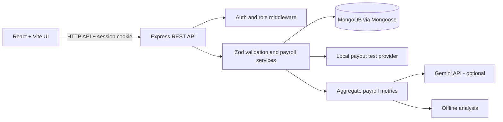

# CloudConduction Payroll

[](https://github.com/shivkumar15/cloudconduction-payroll/actions/workflows/ci.yml)

A full-stack payroll workflow management application built with **React, Node.js, Express, and MongoDB**. It brings employee administration, monthly payroll snapshots, leave and attendance workflows, payslip views, transaction lifecycle tracking, and administrator payroll insights into one role-protected workspace.

**Repository:** https://github.com/shivkumar15/cloudconduction-payroll

> **Payment and payroll scope:** payout processing currently uses a local development/test provider. It does not connect to RazorpayX, call a bank or payment gateway, or transfer money. The payroll formula is simplified and is not a statutory or tax-compliant payroll engine. Use synthetic employee data only.

## Highlights

- **Role-based workspaces:** admin and employee access with protected routes and server-side authorization.
- **Employee management:** validated employee records and salary structures, linked employee logins, search/filtering, account deactivation, and forced password change for newly provisioned employee accounts.
- **Payroll lifecycle:** monthly preview, draft snapshots, approval, finalization, and employee-only access to finalized pay history.
- **Financial precision:** money is represented as integer INR paise at the API/database boundary; salary calculations are server-side and reject deductions greater than gross pay.
- **Leave and attendance:** auditable unpaid-leave requests, approval/rejection flows, WFH requests, server-timestamped attendance, and reasoned correction of missing check-outs.
- **Payout lifecycle testing:** idempotent local payout requests, provider-style references, Processing/Succeeded/Failed states, event history, deduplicated local status events, and retry handling.
- **AI payroll insights:** admin-only insights based on aggregate finalized-period metrics, structured output validation, safe provider errors, and local offline analysis when Gemini quota is unavailable.
- **Security-minded API design:** password hashing, HttpOnly session cookies, role checks, strict request validation, trusted-origin checks for unsafe methods, bounded list queries, and rate limiting.
- **Engineering checks:** unit/API tests, MongoDB-backed integration tests, ESLint, dependency audits, a Vite production build, and GitHub Actions CI.

## Tech stack

| Layer | Technologies |
|---|---|
| Frontend | React 19, Vite, Tailwind CSS v4, React Router, Axios, Recharts, Lucide |
| Backend | Node.js, Express 5, Mongoose |
| Database | MongoDB |
| Validation | Zod, server-side business-rule checks |
| Authentication | Password hashing, signed session token in an HttpOnly cookie, role-based authorization |
| AI insights | Google Gemini API through a server-side integration; deterministic offline analysis is also available |
| Quality | Node test runner, MongoDB integration tests, ESLint, npm audit, GitHub Actions |

## Architecture



The browser does not receive the Gemini API key. Payroll totals and state transitions are calculated and enforced by the backend; AI output is advisory and cannot approve payroll or mutate payroll records.

## Local setup

### Requirements

- Node.js 20 or newer
- npm
- A local MongoDB instance or MongoDB Atlas database

### 1. Get the code and install dependencies

```powershell
git clone https://github.com/shivkumar15/cloudconduction-payroll.git
cd cloudconduction-payroll

npm install
npm install --prefix server
npm install --include=optional --prefix client
```

### 2. Configure the backend

Create a local environment file:

```powershell
Copy-Item server/.env.example server/.env
```

Edit `server/.env` and configure at least:

```dotenv
NODE_ENV=development
PORT=5001
MONGODB_URI=mongodb://127.0.0.1:27017/cloudconduction_payroll
JWT_SECRET=replace_with_a_unique_random_secret_at_least_32_characters
CLIENT_ORIGIN=http://localhost:5173
```

Start MongoDB before starting the application. Keep real credentials in your ignored local `server/.env`; never commit them.

### 3. Create a development admin

Add temporary values to `server/.env`:

```dotenv
SEED_ADMIN_EMAIL=admin@example.com
SEED_ADMIN_PASSWORD=use-a-unique-password-at-least-12-characters
```

From the repository root run:

```powershell
npm run seed:admin --prefix server
```

After provisioning succeeds, remove `SEED_ADMIN_PASSWORD` from `server/.env`. Sign in using the admin email and password you configured.

### 4. Start the app

```powershell
npm run dev
```

- Frontend: http://localhost:5173
- API health check: http://localhost:5001/api/health

### Optional integrations

- **Gemini:** set `GEMINI_API_KEY` in `server/.env` to enable live AI insights. Free-tier access and quotas are controlled by Google, and requests may return HTTP 429. The offline analysis option makes no Gemini API call. Keep billing disabled if you do not intend to pay.
- **Email OTP password reset:** configure the SMTP variables in `server/.env`; password-reset email delivery will not work until SMTP is configured.
- **RazorpayX:** not integrated yet. Account access to the official sandbox is pending; the existing local payout provider is not RazorpayX and does not send funds.

## Render deployment (same-origin session cookies)

For a reliable cookie-based login on Render, deploy the React frontend and Express API from one Render Web Service. Separate `*.onrender.com` frontend and backend hostnames can be cross-site for browser cookie rules, which can cause login to succeed while later authenticated API calls return 401.

Configure the combined Web Service with the repository root as its Root Directory (leave it blank):

- **Build command:** `npm ci && npm ci --prefix server && npm install --include=optional --prefix client && npm run build --prefix client`
- **Start command:** `npm start --prefix server`
- **Environment:** set `NODE_ENV=production`, `MONGODB_URI`, and a strong `JWT_SECRET`.
- **CLIENT_ORIGIN:** set to the exact origin of the combined service, such as `https://your-service.onrender.com`; keep only one entry.
- **VITE_API_URL:** set to `/api` during the frontend build, or leave it unset so production defaults to the same-origin `/api` path.

The Express app serves `client/dist` in production when that build output exists; API routes (including `/api/health`) remain API routes, and other GET routes fall back to `index.html` for React Router. This also keeps the existing API-only service working when `client/dist` is absent.

After deployment, verify `/api/health`, sign in, check `/api/auth/me`, open an authenticated page, refresh it, and test logout. Do not switch `NODE_ENV` away from `production` to enable local payout test actions.

## Testing and quality checks

Run from the repository root:

```powershell
npm test
npm run test:integration --prefix server
npm run lint
npm run build
npm audit --audit-level=high
npm audit --prefix server --audit-level=high
npm audit --prefix client --audit-level=high
```

MongoDB-backed integration tests require a **dedicated disposable test database**. Add a URI with `test` in the database name to `server/.env` before running integration tests:

```dotenv
INTEGRATION_TEST_MONGODB_URI=mongodb://127.0.0.1:27017/cloudconduction_payroll_test
```

Never point integration tests at a production database or one containing real employee data. GitHub Actions runs the configured audits, lint, API tests, MongoDB integration tests, and production build on pushes and pull requests to `main`.

## Local payout workflow

The internal local provider is a development/test harness for exercising a realistic payout state lifecycle without requiring banking details or provider credentials.

1. Preview payroll, create a monthly draft, and approve it.
2. Select **Run payout test**. Each new local payout normally starts in **Processing**.
3. In the payout activity table, apply **Test success event** or **Test failure event** to a processing record.
4. Inspect the provider-style reference and status-event history. Retry failed records to create another processing attempt.
5. Finalize the payroll run only after every payout has succeeded.

Local payout creation, retries and status events are disabled in production. Local status events are not real webhooks; an eventual RazorpayX integration must use the real provider API and verified webhook signatures.

## AI payroll insights

The admin-only insights panel compares finalized payroll periods using server-computed aggregate metrics. The real Gemini endpoint is protected by admin authorization and rate limiting, and validates its structured response. It does not send employee names or salary line items to the model.

When the Gemini free quota is unavailable, select **Run offline analysis (no API call)** to compute a local summary from saved aggregate totals. Offline results are clearly distinguished from Gemini-generated responses.

Use synthetic payroll data when testing AI functionality. Review the provider's data-handling terms before sending any information to an external AI service.

## Important limitations

- Payouts are local test records; no real money is transferred.
- Payroll calculations are simplified and exclude statutory tax, EPF and other compliance calculations.
- Public holidays and custom work schedules are not modeled in unpaid-leave calculations.
- WFH attendance records use server timestamps but do not prove physical location.
- SMTP delivery depends on valid provider configuration.
- A successful CI run does not, by itself, establish production readiness.

See [`docs/PROJECT_PLAN.md`](docs/PROJECT_PLAN.md), [`docs/AI_PAYROLL_INSIGHTS_PLAN.md`](docs/AI_PAYROLL_INSIGHTS_PLAN.md), and [`docs/PHASE_7_SECURITY_RELEASE_CHECKLIST.md`](docs/PHASE_7_SECURITY_RELEASE_CHECKLIST.md) for project status, design decisions, and remaining release checks.
